# GeoLab 2D · diseñador y analizador geométrico

Aplicación de escritorio en **C# / Windows Forms / GDI+** que construye, dibuja, transforma y analiza figuras bidimensionales **calculando cada vértice matemáticamente**, sin coordenadas fijas. Las transformaciones se aplican con **matrices homogéneas 3 × 3**.

   

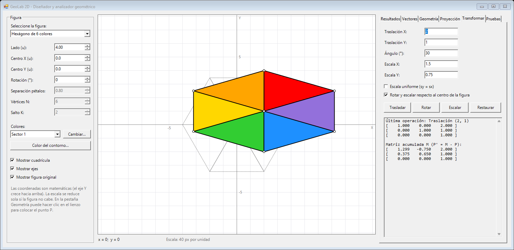

| | |
|---|---|
| **Problema** | Comprender y comprobar visualmente la geometría computacional: construcción de polígonos a partir de parámetros, operaciones vectoriales, proyecciones y transformaciones afines |
| **Objetivo** | Una herramienta interactiva en la que cada resultado (área, perímetro, pertenencia, proyección, matriz acumulada) se calcula con fórmulas propias y se puede verificar en pantalla |
| **Estado** | ✅ Terminado. Compila con MSBuild y pasa 18/18 pruebas (2026-10-28) |
| **Autor** | Edgar Damian Toscano Coro · Estudiante de Ingeniería de Software · Universidad de las Fuerzas Armadas ESPE |

## Contenido

[Capturas](#capturas) · [Funcionalidades](#funcionalidades) · [Tecnologías](#tecnologías) · [Arquitectura](#arquitectura) · [Modelo de datos](#modelo-de-datos) · [Seguridad](#seguridad) · [Instalación](#instalación-y-ejecución-local) · [Pruebas](#pruebas-y-validación) · [Limitaciones](#limitaciones-y-mejoras-futuras) · [Autoría](#autoría-y-créditos)

## Capturas

Capturas reales de la aplicación (2026-10-25).

| Hexágono de seis colores | Margarita de cinco pentágonos (s = 1, se tocan en un vértice) |
|---|---|
| 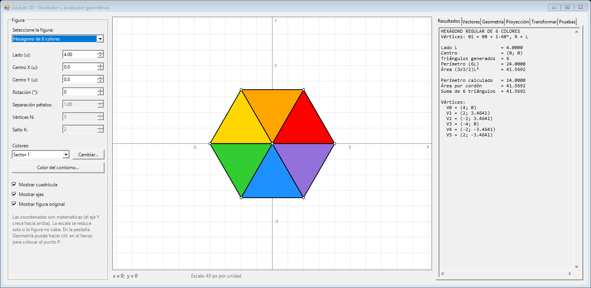 | 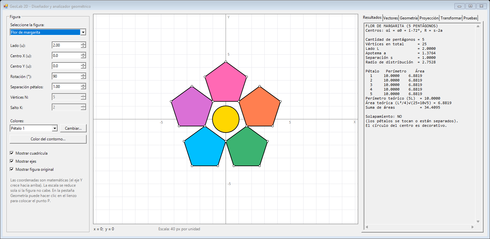 |

| Margarita con pétalos solapados (s = 0,8): se detecta y se informa | Estrella {5/2} |
|---|---|
| 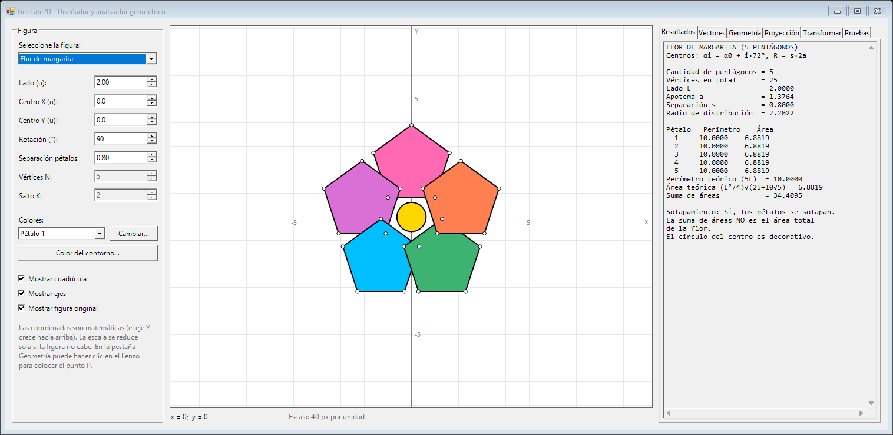 | 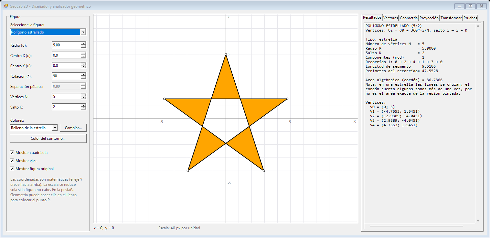 |

| Estrella {7/3} | Estrella {6/2}: dos triángulos, porque mcd(6, 2) > 1 |
|---|---|
| 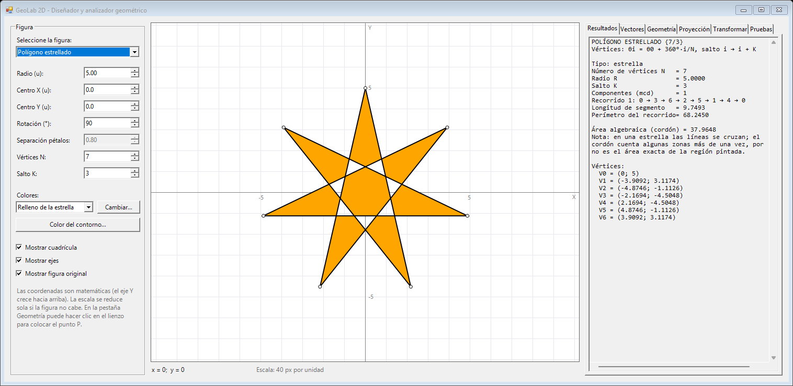 | 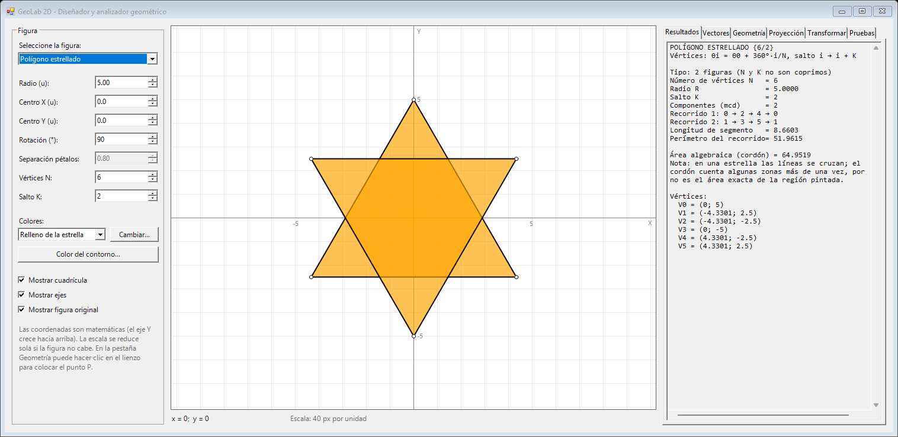 |

| Proyección de un punto sobre un segmento | Operaciones con vectores |
|---|---|
| 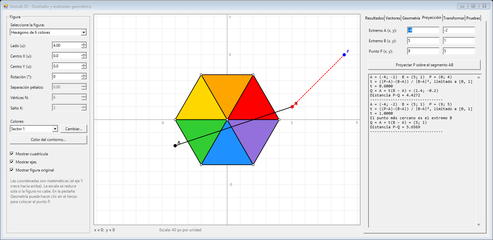 | 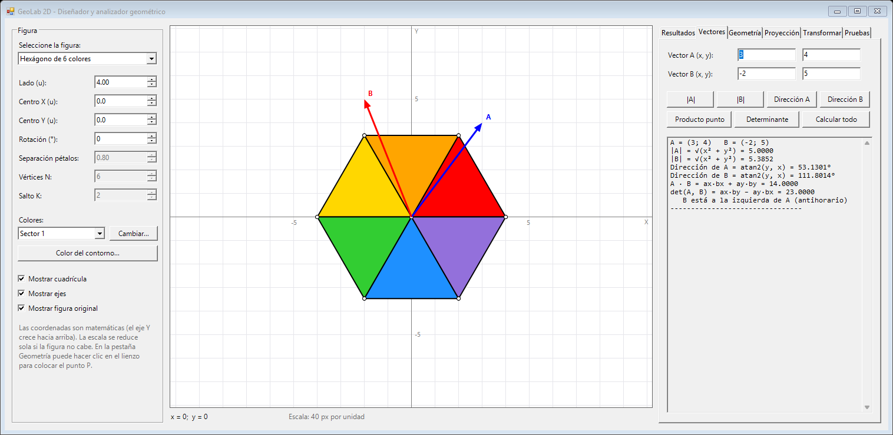 |

| Geometría: área, perímetro, orientación y pertenencia | Pestaña de pruebas: 18/18 |
|---|---|
| 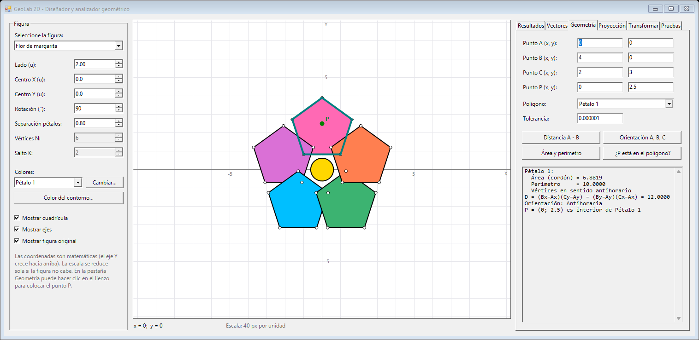 | 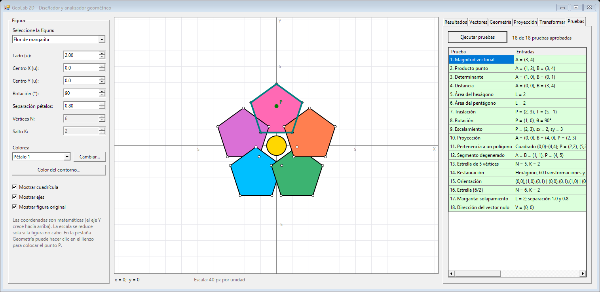 |

## Funcionalidades

### Figuras (construidas por cálculo)

| Figura | Construcción | Parámetros |
|---|---|---|
| Hexágono de seis colores | θᵢ = θ₀ + i·60°, vᵢ = C + L(cos θᵢ, sin θᵢ); seis triángulos (C, vᵢ, vᵢ₊₁) | Lado, centro, rotación, 6 colores, contorno |
| Margarita de cinco pentágonos | Apotema a = L / (2·tan 36°); radio de distribución R = s·2a; centros cada 72° | Lado, separación s (con s < 1 detecta el solapamiento) |
| Polígonos estrellados {N/K} | θᵢ = θ₀ + 360°·i/N; recorrido i → (i + K) mod N; si mcd(N, K) > 1 salen varias figuras | N de 3 a 20, K de 1 a ⌊(N − 1)/2⌋ |

### Operaciones

| Pestaña | Qué calcula |
|---|---|
| **Vectores** | Magnitud, dirección `atan2` en [0°, 360°) (indefinida para el vector nulo), producto punto, determinante |
| **Geometría** | Distancia, área por el método del cordón, perímetro, orientación de tres puntos y pertenencia de un punto (interior, exterior o borde). Un clic en el lienzo coloca el punto |
| **Proyección** | t = ((P − A)·(B − A)) / \|B − A\|², limitado a [0, 1]; Q = A + t(B − A). Si A = B, Q = A |
| **Transformar** | Traslación, rotación y escala (uniforme o no), opcionalmente respecto del centro de la figura; muestra la última matriz y la acumulada |
| **Pruebas** | Ejecuta las 18 pruebas y muestra entradas, valor esperado, valor obtenido y tolerancia |

```
T = [1 0 tx; 0 1 ty; 0 0 1]   R = [cos −sin 0; sin cos 0; 0 0 1]   S = [sx 0 0; 0 sy 0; 0 0 1]
Rotación / escala respecto de C:  M = T(C)·Op·T(−C)
Composición:                      M_nueva = Op · M_actual
```

La figura original **nunca se modifica**: solo se guarda M y se calcula P' = M·P. *Restaurar* hace M = I.

## Tecnologías

| Categoría | Tecnología | Uso |
|---|---|---|
| Lenguaje | C# | Toda la aplicación |
| Plataforma | .NET Framework 4.7.2 | Plantilla de Visual Studio |
| Interfaz | Windows Forms (diseñador de Visual Studio) | `PictureBox`, `TabControl`, `NumericUpDown`, `DataGridView`, etc. |
| Gráficos | GDI+ (`System.Drawing`) | `FillPolygon`, `DrawPolygon`, conversión mundo ↔ pantalla |
| Bibliotecas externas | Ninguna | Todo el cálculo está implementado a mano |
| Herramientas | Visual Studio / MSBuild, PowerShell | Compilación y ejecución de pruebas |

## Arquitectura

```
geolab-2d/
├── GeoLab2D.slnx
├── GeoLab2D/
│   ├── Program.cs                   Punto de entrada
│   ├── MainForm.cs                  Eventos de la interfaz: lee datos, llama a las clases, muestra resultados
│   ├── MainForm.Designer.cs         Controles del diseñador
│   ├── Models/                      Vector2D, Matrix3x3, Polygon2D, GeometryResult
│   ├── Geometry/                    VectorOperations, GeometryOperations, ProjectionOperations, PolygonFactory
│   ├── Transformations/             Transformation2D (matriz acumulada M y restauración)
│   ├── Rendering/                   GeometryRenderer (dibujo GDI+ y conversión de coordenadas)
│   └── Tests/GeometryTests.cs       18 casos de prueba
├── scripts/run-tests.ps1            Compila y ejecuta las pruebas sin abrir la ventana
└── docs/                            Resultados de las pruebas y capturas
```

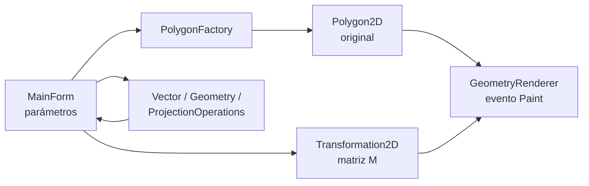

`MainForm` no contiene fórmulas: delega en las clases de `Geometry/` y `Transformations/`, lo que permite probarlas por separado.

**Sistema de coordenadas:** matemático (Y hacia arriba). `GeometryRenderer` convierte a píxeles con xₚ = x₀ + escala·x, yₚ = y₀ − escala·y; la escala normal es 40 px por unidad y se reduce automáticamente si la figura no cabe.

## Modelo de datos

No hay base de datos ni persistencia. Los datos viven en memoria:

| Clase | Contenido |
|---|---|
| `Vector2D` | Punto o vector (x, y) con operadores +, −, k·v |
| `Matrix3x3` | Matriz homogénea; fábricas de traslación, rotación y escala; producto |
| `Polygon2D` | Lista de vértices; área, perímetro y `Transform(M)` |
| `GeometryResult` | `PointLocation` (Inside, Outside, OnBorder) y `ProjectionResult` |

## Seguridad

Es una aplicación de escritorio sin red, cuentas ni almacenamiento, así que no aplican autenticación, sesiones ni inyección. Lo pertinente es la **robustez frente a entradas inválidas**, que está implementada:

- `NumericUpDown` con rangos: lado o radio 0,1–8; centro X ±8, Y ±6; rotación ±360°; separación 0,5–2; N 3–20; K ajustado al cambiar N.
- Campos de texto: acepta punto o coma decimal; texto vacío, letras, NaN o infinito muestran un mensaje, sin excepción no controlada.
- `PolygonFactory` y `Transformation2D` lanzan `ArgumentException` ante radio ≤ 0, K inválido o escala 0.
- Casos degenerados controlados: vector nulo (dirección indefinida) y segmento A = B (sin división entre cero).
- Una transformación que llevaría la figura fuera de |x|, |y| ≤ 50 se rechaza y se deshace.

## Instalación y ejecución local

**Requisitos:** Windows con Visual Studio 2022 o posterior (carga de trabajo *Desarrollo de escritorio con .NET*) o Build Tools con el paquete de destino de .NET Framework 4.7.2.

- **Visual Studio:** abrir `GeoLab2D.slnx` (o `GeoLab2D/GeoLab2D.csproj`) y pulsar **F5**.
- **Línea de comandos** (Developer PowerShell):

```powershell
msbuild GeoLab2D\GeoLab2D.csproj -p:Configuration=Debug
.\GeoLab2D\bin\Debug\GeoLab2D.exe
```

| Problema | Solución |
|---|---|
| «No se encontró el paquete de destino 4.7.2» | Instalar *.NET Framework 4.7.2 targeting pack* desde el instalador de Visual Studio |
| `.slnx` no se abre | Versiones antiguas de Visual Studio: abrir el `.csproj` |

## Pruebas y validación

```powershell
powershell -ExecutionPolicy Bypass -File scripts\run-tests.ps1
```

Compila el proyecto y ejecuta `GeometryTests.RunAll()`, el mismo código del botón **Pruebas → Ejecutar pruebas**.

| Grupo | Pruebas |
|---|---|
| Vectores | Magnitud, producto punto, determinante, dirección del vector nulo |
| Geometría | Distancia, área del hexágono, área del pentágono, pertenencia, orientación, segmento degenerado |
| Transformaciones | Traslación, rotación, escalamiento, restauración |
| Figuras | Proyección, estrella de 5 vértices, estrella {6/2}, solapamiento de la margarita |
| **Total** | ✅ **18/18** (2026-10-28) · detalle con entradas y tolerancias en [`docs/Resultados_Pruebas.md`](docs/Resultados_Pruebas.md) |

Las pruebas son propias (sin un framework como MSTest o NUnit), para poder ejecutarlas desde la interfaz.

## Limitaciones y mejoras futuras

- Con pétalos solapados (s < 1) no se calcula el área de la unión; la aplicación advierte que la suma de áreas no es el área de la flor.
- En las estrellas, el método del cordón da el área algebraica y la pertenencia usa la regla par-impar (el pentágono central de {5/2} cuenta como exterior).
- Las figuras no usan herencia: cada una se construye con un método de `PolygonFactory`.
- Mejoras posibles: migrar las pruebas a MSTest o xUnit para integrarlas en CI, exportar figuras a SVG y portar a .NET 8 (WinForms).

## Autoría y créditos

**Desarrollador: Edgar Damian Toscano Coro**
Estudiante de Ingeniería de Software
Universidad de las Fuerzas Armadas ESPE

Proyecto académico individual (Tarea 02: GeoLab 2D). Sin dependencias de terceros más allá de .NET Framework.

Distribuido bajo la [licencia MIT](LICENSE).
